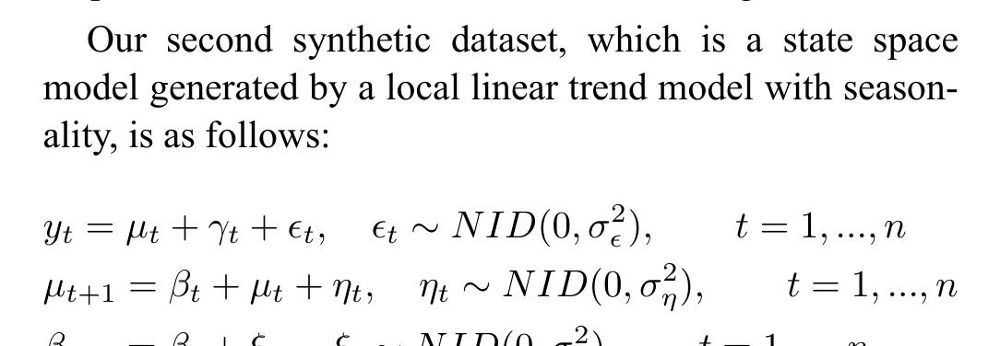
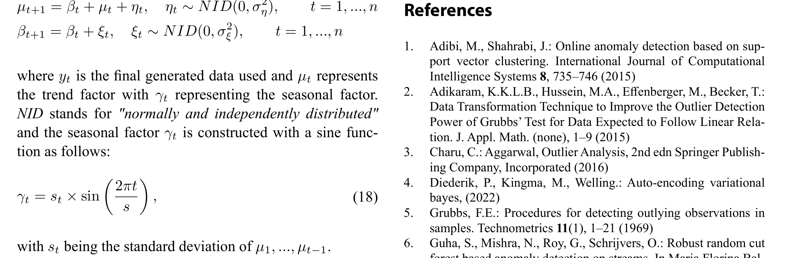
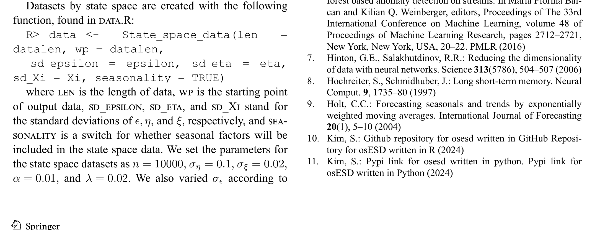
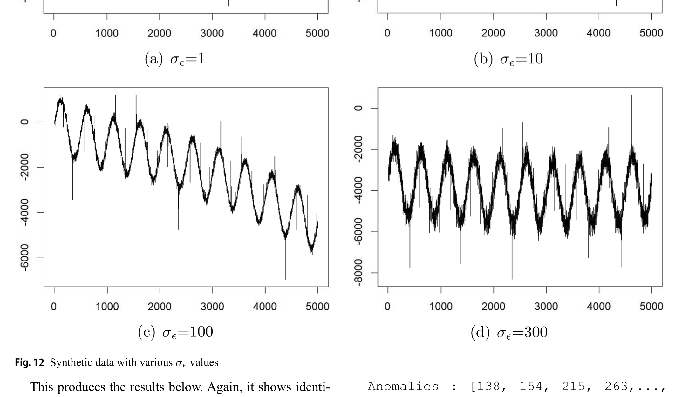
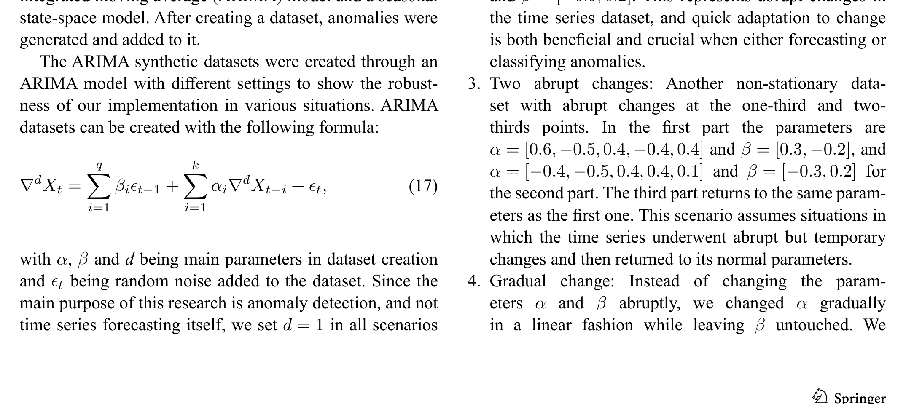
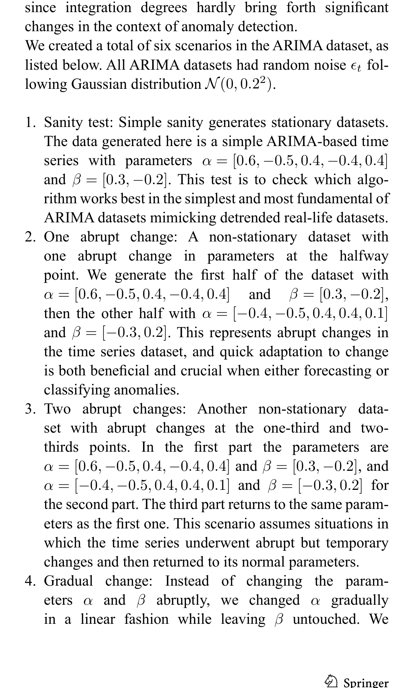

# osESD 논문 부록 파라미터 및 생성 모델 정밀 분석

## 1. State-Space 합성 데이터셋 (Table 2(g) 재현용)

논문 PDF 29~30쪽 부록 "Creating datasets"의 상태공간 모델 수식 및 파라미터는 다음과 같습니다.

### (1) 모델 정의 수식 (수식 18 및 주변)

- **관측 방정식**:
  $$y_t = \mu_t + \gamma_t + \epsilon_t, \quad \epsilon_t \sim NID(0, \sigma_\epsilon^2), \quad t=1,\dots,n$$
- **상태 전이 방정식 (로컬 선형 추세)**:
  $$\mu_{t+1} = \beta_t + \mu_t + \eta_t, \quad \eta_t \sim NID(0, \sigma_\eta^2), \quad t=1,\dots,n$$
  $$\beta_{t+1} = \beta_t + \xi_t, \quad \xi_t \sim NID(0, \sigma_\xi^2), \quad t=1,\dots,n$$
- **계절성 성분 (수식 18)**:
  $$\gamma_t = s_t \times \sin\left(\frac{2\pi t}{s}\right)$$
  - 여기서 $s_t$는 $\mu_1, \dots, \mu_{t-1}$의 표본 표준편차이며(R 코드는 $y$의 누적 표준편차 사용), $s$는 계절 주기($s = \text{len} \times 0.1 = 1000$).

---

### (2) 파라미터 수치

- 데이터 길이 $n = 10000$
- 레벨 노이즈 표준편차 $\sigma_\eta = 0.1$
- 기울기(추세) 노이즈 표준편차 $\sigma_\xi = 0.02$
- 이상치 주입 신뢰수준 파라미터 $\alpha = 0.01$ (임계값 $z_{1 - \alpha/2} = z_{0.995} \approx 2.576$)
- 이상치 비율 $\lambda = 0.02$ (2%, 10,000개 중 약 200개 이상치)
- 노이즈 조건 $\sigma_\epsilon$: 아래 Fig. 12에 따라 다양하게 변경

---

### (3) Fig. 12: 다양한 $\sigma_\epsilon$ 조건

- **Fig. 12 캡션**: `Synthetic data with various \sigma_\epsilon values`
  - (a) $\sigma_\epsilon = 1$
  - (b) $\sigma_\epsilon = 10$
  - (c) $\sigma_\epsilon = 100$
  - (d) $\sigma_\epsilon = 300$

---

## 2. ARIMA 합성 데이터셋 모델 및 수식 (17)

- **수식 (17)**:
  $$\nabla^d X_t = \sum_{i=1}^q \beta_i \epsilon_{t-1} + \sum_{i=1}^k \alpha_i \nabla^d X_{t-i} + \epsilon_t$$
  - 논문 수식의 MA 첨자는 $\epsilon_{t-1}$로 오타가 있으나, 실제 코드는 $\epsilon_{t-i}$ 형태임.
  - 차분 차수 $d = 1$ 고정.
- **논문과 코드의 계수 차이**:
  - **기본 AR 계수**:
    - **논문 텍스트**: $\alpha = [0.6, -0.5, 0.4, -0.4, \mathbf{0.4}]$ (마지막 계수가 0.4)
    - **R 코드 (`data_functions.R`)**: $\alpha = [0.6, -0.5, 0.4, -0.4, \mathbf{0.3}]$ (마지막 계수가 0.3)
  - **시나리오 3**:
    - **논문 텍스트**: 3구간이 1구간 계수로 복귀한다고 서술.
    - **R 코드**: 3구간에 제3의 별도 계수 세트 `(0.5, -0.3, 0.5, -0.6, 0.4) / (0.2, -0.3)` 사용.
  - **노이즈**:
    - **논문 텍스트**: 가우시안 $N(0, 0.2^2)$
    - **R 코드**: 기본값 `noise = 0.3`, 시나리오 2/3은 균등분포 `runif(-noise, noise)`.

---

## 3. 샘플 데이터 진단 결과 (`check_generators.py`)

저자 저장소(`osESD_R/data`)의 샘플 시계열 4종에 대한 실측 결과:

| 파일명 | N | 이상치 수 | 이상치 비율 | 추정 주기 | 진폭(Amplitude) | 잔차 SD |
| :--- | :---: | :---: | :---: | :---: | :---: | :---: |
| `seasonal_ber_6.csv` | 10000 | 91 | 0.91% | **701** | **5.00** | **0.529** |
| `seasonal_ber_16.csv` | 10000 | 98 | 0.98% | **700** | **4.99** | **0.513** |
| `ARIMA3_lin_4.csv` | 10000 | 205 | 2.05% | - | 0.00 | 4.787 |
| `ARIMA5_quad_2.csv` | 10000 | 168 | 1.68% | - | 0.00 | 23.301 |

- **결론**: `seasonal_ber_*.csv` 샘플은 주기 $\approx 700$, 진폭 $\approx 5.0$, 잔차 $\text{SD} \approx 0.51$로, 논문의 State-space 모델이 아니라 R 코드의 주석 처리된 `new_data()` 함수에 의해 생성되었음이 확인됨.
